

  <a href="https://panic-slide-studio.vercel.app">
    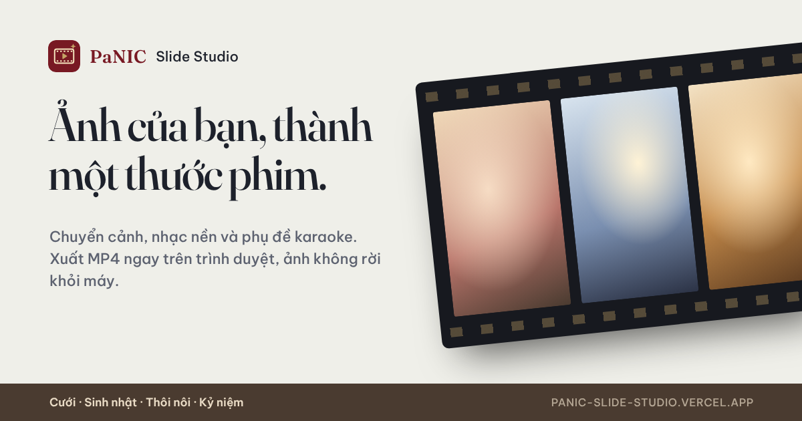
  </a>

<h1 align="center">PaNIC Slide Studio</h1>

  Biến một thư mục ảnh cưới, sinh nhật hay kỷ niệm gia đình thành video có chuyển cảnh, 
  nhạc nền và lời bài hát chạy theo nhạc, xong trong vài phút.

  <a href="https://panic-slide-studio.vercel.app"><b>Mở website →</b></a>
  &nbsp;·&nbsp; Miễn phí &nbsp;·&nbsp; Không cần tài khoản &nbsp;·&nbsp; Ảnh không rời khỏi máy bạn

---

## Dành cho ai?

Cho bất kỳ ai muốn có một video trình chiếu đẹp cho ngày vui mà không phải học phần mềm dựng phim: chiếu ở tiệc cưới, tiệc sinh nhật, buổi họp mặt gia đình, hoặc gửi cho người thân. Bạn chỉ cần thả ảnh vào, chọn chủ đề và bài hát, còn lại PaNIC Slide Studio lo: sắp ảnh thành slide, ghép ảnh, chọn chuyển cảnh, căn thời gian cho khớp với nhạc.

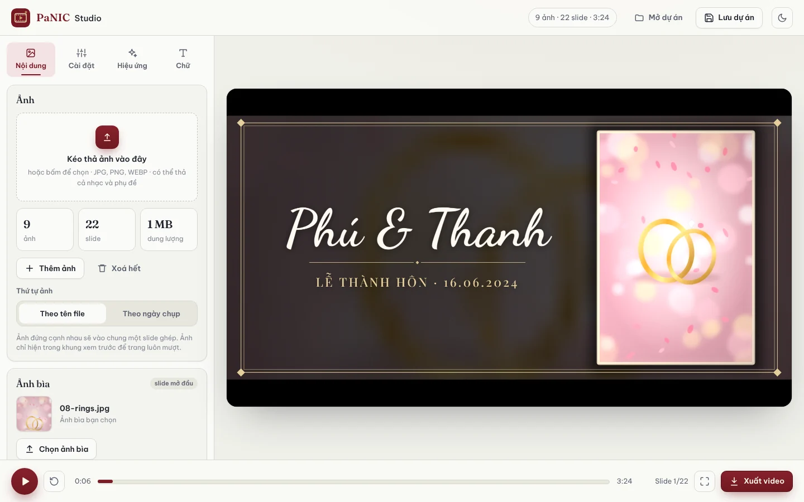

## Mục lục

- [Ba chủ đề, ba slide mở đầu riêng](#ba-chủ-đề-ba-slide-mở-đầu-riêng)
- [Ảnh bìa](#ảnh-bìa)
- [Slide ghép ảnh](#slide-ghép-ảnh)
- [17 kiểu chuyển cảnh](#17-kiểu-chuyển-cảnh)
- [Bộ lọc màu và kiểu khung](#bộ-lọc-màu-và-kiểu-khung)
- [Hiệu ứng hạt](#hiệu-ứng-hạt)
- [Nhạc nền luôn khớp với video](#nhạc-nền-luôn-khớp-với-video)
- [Lời bài hát chạy theo nhạc](#lời-bài-hát-chạy-theo-nhạc)
- [Chữ trên video](#chữ-trên-video)
- [Xuất video](#xuất-video)
- [Lưu dự án để dùng lại](#lưu-dự-án-để-dùng-lại)
- [Chế độ tối, toàn màn hình, điện thoại](#chế-độ-tối-toàn-màn-hình-điện-thoại)

---

## Ba chủ đề, ba slide mở đầu riêng

| Chủ đề | Dùng cho | Không khí |
|---|---|---|
| 💍 **Cưới** | Lễ cưới, ăn hỏi, kỷ niệm ngày cưới | Khung vàng kiểu điện ảnh, tên cô dâu chú rể viết tay, cánh hoa và trái tim bay |
| 🎂 **Sinh nhật** | Mọi lứa tuổi, từ thôi nôi, sinh nhật bé, tới mừng thọ ông bà | Tia sáng xoay, chữ nảy, pháo giấy và bóng bay |
| 📷 **Kỷ niệm** | Album gia đình, chuyến đi, những năm tháng đã qua | Tông phim ấm, khung Polaroid, bụi phim và đốm sáng |

Mỗi chủ đề có sẵn màu sắc, kiểu chữ, câu chữ trang trí, chuyển cảnh, hiệu ứng và nhạc nền riêng. Slide đầu tiên được thiết kế đặc biệt và trình chiếu lâu hơn các slide khác, để video có một màn mở đầu thật trang trọng.

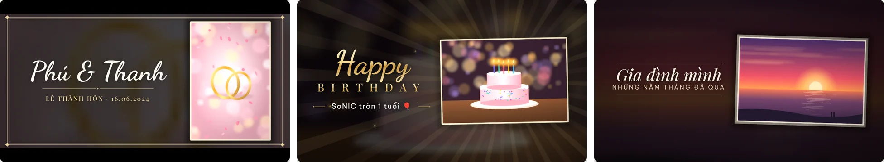

## Ảnh bìa

Chọn một tấm ảnh bạn thích nhất làm **ảnh bìa** cho slide mở đầu. Ảnh được đặt cạnh tiêu đề trong khung phù hợp với chủ đề. Nếu bạn không chọn, ảnh đầu tiên sẽ được dùng.

## Slide ghép ảnh

Bên cạnh slide một ảnh, PaNIC Slide Studio tự xen kẽ các **slide ghép 2 đến 5 ảnh** với bố cục cân đối, kèm một câu trang trí nhỏ như *Just married*, *Happy day!*, *Our story*. Bạn có thể tắt slide ghép, hoặc chọn câu trang trí nào được hiện.

Ít ảnh mà bài hát dài? Ảnh sẽ được lặp lại theo thứ tự ngẫu nhiên để video luôn đủ dài mà không nhàm chán.

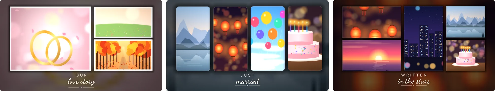

## 17 kiểu chuyển cảnh

Từ nhẹ nhàng như hoà tan, vệt sáng, gạt mềm, tới sôi động như lá sách, cháy phim, gợn nước, cắt lát, nhiễu RGB… Dùng bộ chuyển cảnh gợi ý của chủ đề, chọn nhanh nhóm *Nhẹ nhàng* hoặc *Sôi động*, hoặc tự tick từng kiểu mình thích.

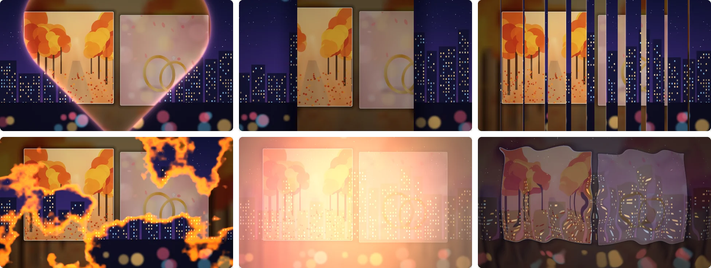

Trái tim · Mở cửa · Lá sách · Cháy phim · Vệt sáng · Gợn nước

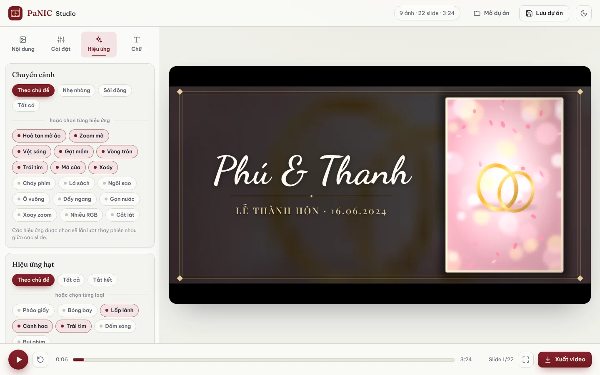

## Bộ lọc màu và kiểu khung

**7 bộ lọc màu** cho cả video: Tự nhiên, Ấm áp, Tươi sáng, Pastel trong trẻo, Mơ màng, Hoài cổ, Đen trắng.

**5 kiểu khung ảnh**: Bo góc mềm, Viền mảnh, Tối giản, Polaroid, hoặc kết hợp để mỗi slide một kiểu. Video có thể làm **ngang 16:9** để chiếu màn hình lớn, hoặc **dọc 9:16** để đăng lên điện thoại.

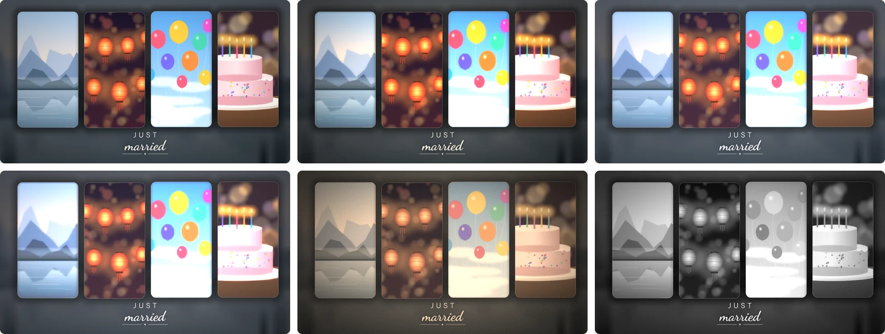

Tự nhiên · Ấm áp · Pastel · Mơ màng · Hoài cổ · Đen trắng

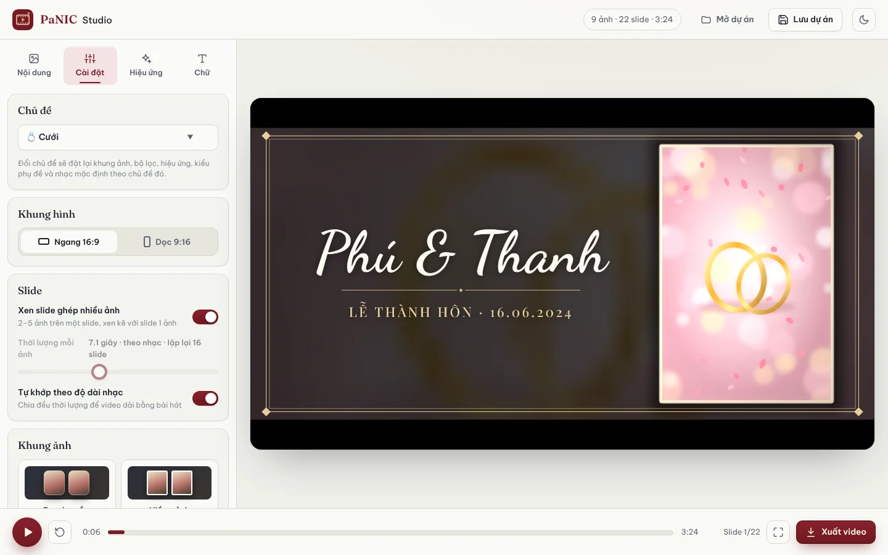

## Hiệu ứng hạt

Pháo giấy, bóng bay, lấp lánh, cánh hoa, trái tim, đốm sáng, bụi phim. Chọn hiệu ứng nào xuất hiện và chỉnh độ dày, để nó bay **liên tục** suốt video hoặc chỉ bùng lên làm **điểm nhấn** lúc mở đầu, kết thúc và mỗi lần chuyển cảnh.

## Nhạc nền luôn khớp với video

Dùng nhạc có sẵn của chủ đề, hoặc chọn bài hát của bạn. PaNIC Slide Studio tự căn thời gian từng slide để **video kết thúc đúng lúc bài hát kết thúc**, không bị cắt ngang giữa chừng. Muốn tự đặt nhịp? Tắt chế độ *Tự khớp theo độ dài nhạc* và chọn số giây cho mỗi slide.

## Lời bài hát chạy theo nhạc

Thêm file lời bài hát (SRT hoặc VTT) để lời hiện trên video theo đúng nhịp, sáng dần từng chữ như karaoke. Chủ đề Sinh nhật dùng kiểu chữ dán vui nhộn, chủ đề Cưới và Kỷ niệm dùng kiểu chữ viết tay thanh lịch.

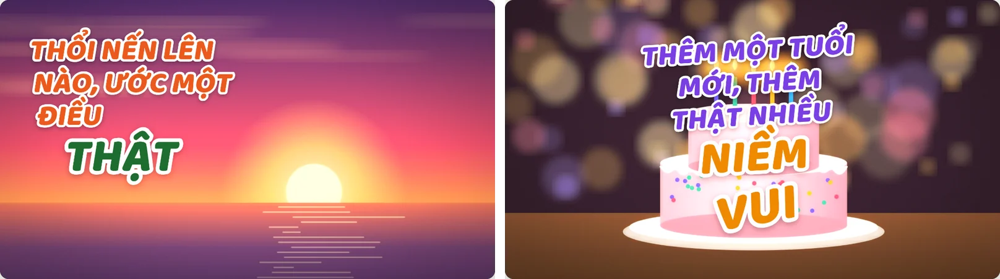

Không có sẵn file lời? Mở **Sửa lời / đồng bộ**:

- **Căn lại thời gian**: sửa chính tả hoặc thêm chữ còn thiếu vào phụ đề có sẵn, thời gian được giữ nguyên.
- **Gõ nhịp theo nhạc**: dán lời bài hát, cho nhạc phát và bấm đúng lúc mỗi câu bắt đầu.
- **Tải file .vtt** về để lần sau dùng lại.

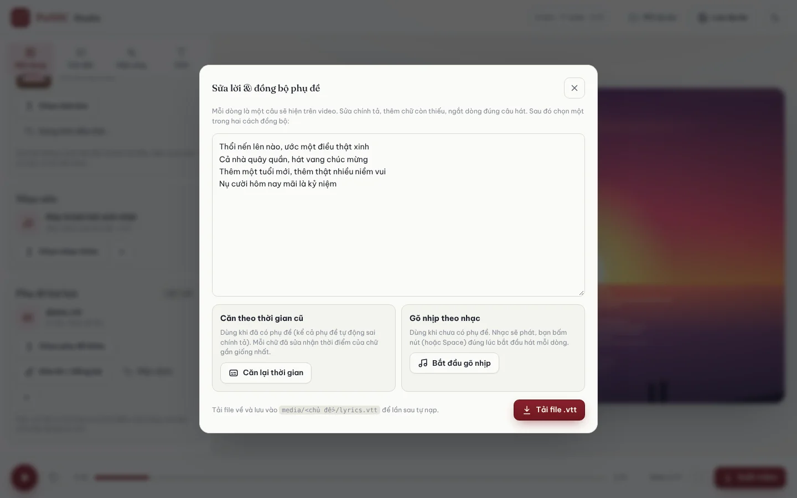

## Chữ trên video

Tab **Chữ** cho phép sửa tiêu đề, dòng phụ ở slide mở đầu và lời kết ở cuối video, cùng các câu trang trí trên slide ghép. Đổi chủ đề thì chữ mẫu đổi theo chủ đề mới; nếu bạn đã tự gõ chữ, một nút **Giữ chữ cũ** cho phép lấy lại ngay.

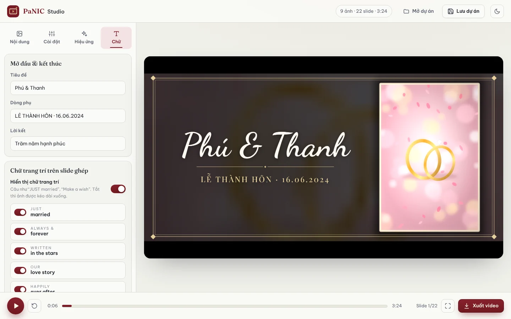

## Xuất video

Bấm **Xuất video** để tạo file video kèm nhạc, sẵn sàng chép vào USB, chiếu ở tiệc hoặc gửi cho người thân. Ảnh của bạn được xử lý ngay trên máy, không tải lên đâu cả.

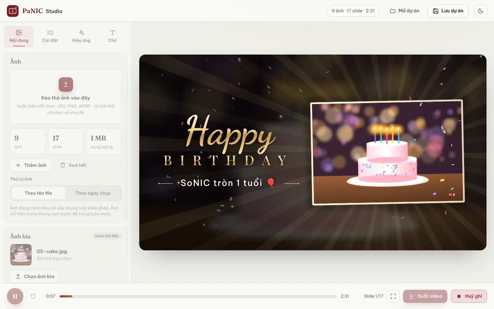

> [!TIP]
> Nên dùng **Chrome** hoặc **Edge** trên máy tính để xuất video MP4. Trong lúc xuất, hãy để tab mở và không chuyển sang tab khác.

## Lưu dự án để dùng lại

**Lưu dự án** giữ lại toàn bộ lựa chọn của bạn (chủ đề, chữ, bộ lọc, chuyển cảnh, hiệu ứng…) thành một file nhỏ. Lần sau chỉ cần **Mở dự án** và thả ảnh vào là có ngay video cùng phong cách, rất tiện cho sinh nhật hằng năm hay nhiều buổi tiệc của cùng một sự kiện.

## Chế độ tối, toàn màn hình, điện thoại

**Chế độ tối** tự theo cài đặt của máy, hoặc bật tắt bằng biểu tượng mặt trăng.

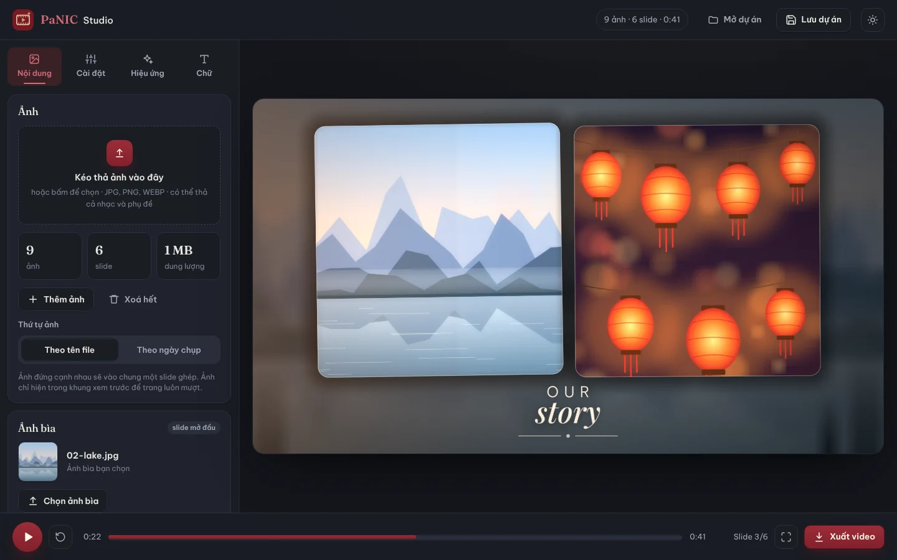

**Trên điện thoại**, khung xem trước nằm trên cùng, nút phát, phát lại và xuất video luôn ở đáy màn hình. Bấm **toàn màn hình** để xem video trọn màn hình, chạm vào video để tạm dừng.

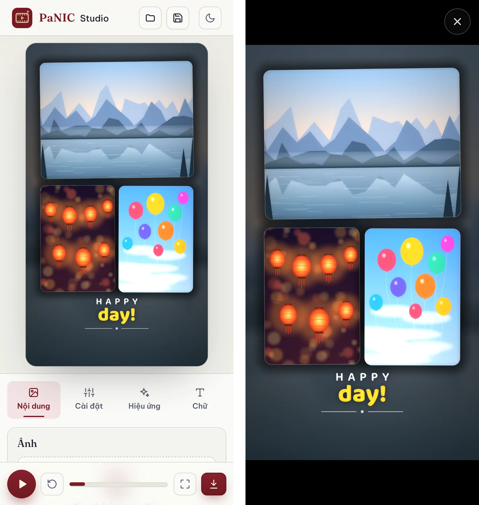

---

## Bắt đầu trong ba bước

1. Mở **[panic-slide-studio.vercel.app](https://panic-slide-studio.vercel.app)**, chọn chủ đề ở tab **Cài đặt**.
2. Kéo thả ảnh vào trang, chọn ảnh bìa, bài hát và lời bài hát nếu có.
3. Bấm ▶ để xem thử, chỉnh lại cho vừa ý, rồi bấm **Xuất video**.

## Phím tắt

| Phím | Tác dụng |
|---|---|
| `Space` | Phát / tạm dừng |
| `F` | Toàn màn hình |
| `←` `→` (trên thanh thời gian) | Lùi / tới 5 giây |

## Lưu ý

- Hãy dùng những bài hát và hình ảnh bạn có quyền sử dụng, nhất là khi đăng video lên mạng.
- Lựa chọn của bạn được lưu trên trình duyệt đang dùng. Ảnh và nhạc thì không được lưu, nên khi mở lại cần thả lại ảnh (hoặc dùng **Mở dự án**).

Made with ❤️ by <a href="https://github.com/mdev-qn95">mdev-qn95</a>

